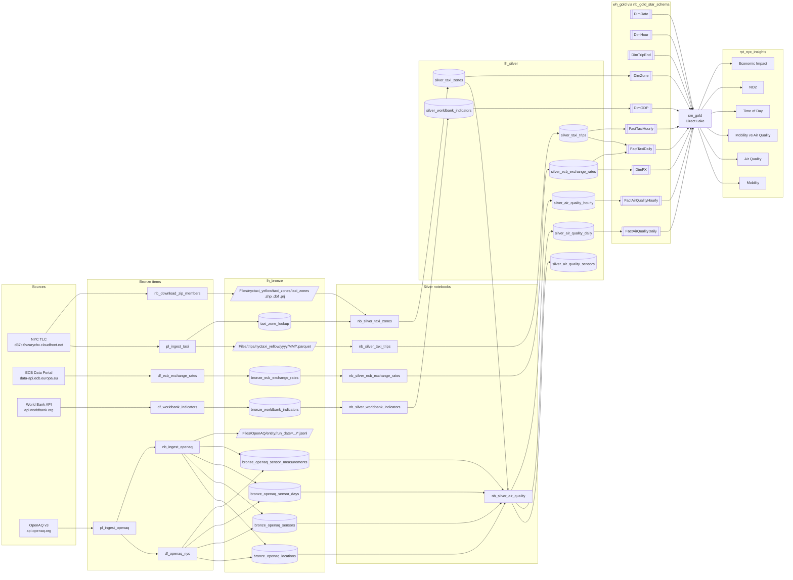

# Lineage

How each source travels from its API or file server through bronze (`lh_bronze`), silver (`lh_silver`) and gold
(`wh_gold`) into the `sm_gold` semantic model and the pages of `rpt_nyc_insights`. Column level detail is in
[data_dictionary.md](data_dictionary.md).

## Gold tables per report page

| Page | Gold tables behind its visuals |
|---|---|
| Mobility | `FactTaxiDaily`, `DimDate`, `DimZone`, `DimTripEnd` |
| Air Quality | `FactAirQualityDaily`, `DimDate`, `DimZone` |
| Mobility vs Air Quality | `FactTaxiDaily`, `FactTaxiHourly`, `FactAirQualityDaily`, `FactAirQualityHourly`, `DimDate`, `DimZone`, `DimTripEnd` |
| Time of Day | `FactTaxiHourly`, `FactAirQualityHourly`, `DimHour`, `DimDate`, `DimZone`, `DimTripEnd` |
| NO2 | `FactAirQualityDaily`, `FactAirQualityHourly`, `FactTaxiHourly`, `DimHour`, `DimDate`, `DimZone` |
| Economic Impact | `FactTaxiDaily`, `FactAirQualityDaily`, `DimFX`, `DimGDP`, `DimDate` |

Notes:

* `DimDate`, `DimHour` and `DimTripEnd` are generated in `nb_gold_star_schema`, not read from silver.
* `nb_ingest_openaq` is the backfill path of `pl_ingest_openaq` (`run_backfill = true`); the scheduled runs use
  `df_openaq_nyc`. Both write the same `bronze_openaq_*` tables, and silver keeps the latest `ingested_at` per key.
* `nb_silver_air_quality` reads `silver_taxi_zones` to place every sensor in a taxi zone, so
  `pl_silver_startup` rebuilds taxi zones first.
* `nb_compact_bronze_tables` compacts the OpenAQ fact tables in place; it changes files, not lineage.

## Fabric lineage view

Fabric draws item level lineage on its own: in the workspace, switch the view to **Lineage** (or open an item's
**Lineage** from its menu) to see the dataflows, pipelines, notebooks, lakehouses, warehouse, semantic model and
report with their upstream and downstream items. It follows the links Fabric knows about (data destinations, pipeline
activities, the Direct Lake connection), so it shows which items depend on which, while this page adds the tables in
between and which report page reads which gold table.
